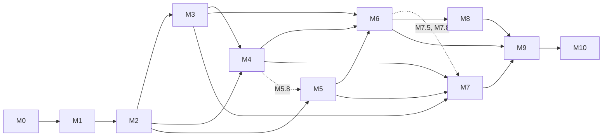

# cfgx — Roadmap to the first release

> Status: **active plan**, written 2026-11-07. Module: `github.com/epistemer/cfgx`.
>
> | Document | Answers |
> |----------|---------|
> | [interface.md](interface.md) | *What* the developer writes and gets back (locked) |
> | [implementation.md](implementation.md) | *How* it's built |
> | this file | *In what order*, and *when each piece counts as done* |

## How to use this document

- **Ownership.** Until `v1.0.0`, Claude owns the project for epistemer. The
  terms are in [ownership.md](ownership.md); every session is logged in
  [status.md](status.md).
- **IDs.** Every work item has an ID (`M3.2`), and each item is sized to fit one
  PR or one focused working session. Branch names, PR titles and commit
  subjects start with the ID: `M3.2: file discovery`.
- **Checkboxes.** Tick an item's box when it meets its *Done when* column and the
  [definition of done](#definition-of-done-every-work-item).
- **Changing the interface.** A change to the developer interface is an
  *amendment*. Record it in [interface.md §12](interface.md) in the same PR,
  with the reason.
- **ADRs.** Each spike outcome and any decision not already recorded gets an ADR
  in `docs/adr/NNNN-title.md`.
- **Versions.** In the other documents, "v1" means *the first usable release*.
  Tag it **`v0.1.0`**. Keep `v1.0.0`, which carries Go's compatibility promise,
  for after the zp port (M10) has proven the API.
- **Sizes.** S is up to 1 day, M is 2–3 days, L is about 1 week, for one
  developer working without AI help. They're for sequencing work, not for
  promising dates.

---

## Overview

| Milestone | Goal | Size (days) | Needs |
|-----------|------|-------------|-------|
| [M0](#m0--repository-foundation) | Repository, CI, test harness | ~5 | – |
| [M1](#m1--spikes) | Spikes S1–S5: remove the big unknowns | ~10 | M0 |
| [M2](#m2--walking-skeleton) | Walking skeleton: schema → generated code → running binary | ~18 | S1, S2, S3 |
| [M3](#m3--config-files-errors-provenance) | Config files, errors, provenance | ~13 | M2, S4 |
| [M4](#m4--full-key-vocabulary) | Every key type and modifier | ~20 | M2 (file parts: M3) |
| [M5](#m5--schema-structure-and-semantics) | Tags, rules, computed values, generate-time checks | ~18 | M2 (M5.8 also M4) |
| [M6](#m6--developer-surface) | Generated files, `config` command, test helpers | ~18 | M3, M4, M5 |
| [M7](#m7--mutable-settings--bbolt) | Runtime-mutable settings, built-in bbolt store, admin API | ~25 | M3, M4, M5 (M7.5 also M6.1; M7.8 also M6.4) |
| [M8](#m8--cfgx-init) | `cfgx init` scaffolding | ~5 | M6 |
| [M9](#m9--hardening-and-v010) | Hardening, benchmarks, **v0.1.0** | ~10 | M6, M7, M8 |
| [M10](#m10--dogfood-port-zp) | Port zp to cfgx; decide on v1.0.0 | ~10 | M9 |

The total to v0.1.0 is about 140 developer-days, roughly 28 weeks for one
person working alone. With two people in parallel lanes (see
[Parallel work](#parallel-work)), the longest chain is about 18 weeks. (An
earlier version of this file said 15 weeks; that was a miscalculation.) With
agents writing most of the code, the limit moves from typing to reviews and
decisions: see [Working with agents](#working-with-agents).

The two biggest cost centres are M4 and M7. If an earlier release matters more
than the full vocabulary, M4 can be cut to Duration, Enum, Secret, SecretFile,
Path and Strings, and the rest moved after v0.1.0.

---

## Definition of done (every work item)

1. Code and unit tests are written, and `go test -race ./...` passes on the
   whole CI matrix.
2. If generator output changed, the golden files are updated and the diff has
   been reviewed.
3. Behaviour a user can see is covered by a `testscript` case.
4. Every exported identifier has godoc.
5. If the behaviour differs from interface.md or implementation.md, that
   document is updated in the same PR.
6. A new runtime dependency needs an ADR.
7. Generated code never imports `cfgx/dsl` (enforced by a test from M2.5 on).

---

## Where each original problem gets solved

| Problem from the original brief | Solved by |
|---------------------------------|-----------|
| 1. Command-first design | M2: commands are config profiles with typed binders. M5: tags and `Uses`. |
| 2. Type safety without slow startup | M2: generated tables and getters, no runtime reflection. M4: typed key kinds. M9: benchmark that checks the startup claim. |
| 3. Manual rewiring for every project | M6: example files, JSON Schema, docs, completion, `config` command. M8: `cfgx init`. |
| 4. Adding a setting is painful | M2–M6: one schema line plus `go generate` updates every surface. |

---

## M0 — Repository foundation

**Goal:** an empty repository where CI, linting and the end-to-end test harness
already work, so every later PR is tested the same way.

**Status (2026-11-07):** complete and merged into `main`. The
[first CI run](https://github.com/epistemer/cfgx/actions/runs/42413478830) passed
all six jobs, and the e2e script really ran on every OS (1.1–1.7 s per job, not
a skip). Gemini wrote M0.2 and M0.3 and Claude reviewed them; Gemini reviewed
M0.1 and M0.4, and its seven findings are fixed.

| ✓ | ID | Item | Size | Done when |
|---|----|------|------|-----------|
| ☑ | M0.1 | `git init`. Module `github.com/epistemer/cfgx` with a `go 1.26` directive (support the two latest Go releases). Package directories from [implementation.md §4](implementation.md), each with a `doc.go`. MIT LICENSE and a README stub. | S | `go build ./...` passes; layout matches §4 |
| ☑ | M0.2 | CI (GitHub Actions): Go {1.26, 1.27} × {linux, macOS, windows}. Runs `gofmt` check, `go vet`, `staticcheck`, `go test -race`. Windows is in the matrix from day one because env var names are case-insensitive there and paths differ. | S | CI green on all six jobs |
| ☑ | M0.3 | Test harness. A `testscript` runner in `internal/e2e` whose setup creates a temporary module containing `replace github.com/epistemer/cfgx => <repo>`. A golden-file helper with an `-update` flag. | M | A trivial script (`go build` inside a temp module) passes on all three OSes |
| ☑ | M0.4 | `docs/adr/` with a template, plus ADR-0001 recording decisions D1–D11 by linking interface.md §0. | S | Merged |
| ☑ | M0.5 | Cross-model review: agy's adversarial review (Gemini 4 Argon) of the three docs. Every finding becomes an amendment, a roadmap change, or a recorded rejection. Done on 2026-11-07: [review 0001](reviews/0001-gemini-doc-review.md). | S | Triage list merged (it lands with M0.1's first commit) |

**Exit:** CI is green on empty packages, and the e2e harness runs everywhere.

---

## M1 — Spikes

**Goal:** answer the five questions that could change the design, before any
production code depends on the answers. Spike code is throwaway: it lives in
`spikes/` and is deleted when its ADR merges. The five spikes are independent
and can run in parallel. The questions and kill criteria are in
[implementation.md §6](implementation.md).

**Status (2026-11-07):** done. All five spikes passed and none of the kill
criteria fired; the decisions are ADRs 0002–0006. The spike code was deleted when
they merged, except `spikes/s5-secret`, whose leak suite moves into package
`cfgx` in M4.3.

| ✓ | ID | Spike | Size | Done when |
|---|----|-------|------|-----------|
| ☑ | M1.1 | **S1: generator pipeline.** A temporary `main` package plus `go run`. Test a schema that imports `internal/` packages, with `go.work`, with `-mod=vendor`, and from inside `go generate`. Measure cold and warm times. Decide where the temporary `main` lives without touching the working tree (`-overlay`, `_` or `.` directories). | M | ADR with timings, the placement decision, and keep-or-fallback |
| ☑ | M1.2 | **S2: flags.** A custom `pflag.Value` with `Changed` semantics, cobra persistent flags merged into a child command, completion, and `--help` default display. | M | ADR plus a working proof of correct precedence |
| ☑ | M1.3 | **S3: function references.** Turn `FuncForPC` names into importable references. Cover top-level, `internal/`, generic, closure and method-expression cases, `%2e`-escaped paths, ABI wrappers, and functions in the schema package (rejected). | S | ADR with the accepted and rejected name patterns |
| ☑ | M1.4 | **S4: YAML library.** Compare candidates on node positions, strict duplicate keys, JSON input, maintenance, and dependency weight. | M | ADR naming the library |
| ☑ | M1.5 | **S5: Secret leaks.** Check every `fmt` verb, nested exported and unexported fields, json, slog text and JSON handlers, `errors`, and reflection dumpers (`spew`, `go-cmp`) against the closure-based Secret. | S | ADR plus a leak test suite, kept for M4.3 |

**Exit:** five ADRs are merged. If a kill criterion fired, implementation.md is
amended to the fallback before M2 starts.

---

## M2 — Walking skeleton

**Goal:** the thinnest end-to-end path. A three-key schema goes through
`go generate` and comes out as a binary whose values come from defaults, env
vars and flags, in the correct precedence. The whole pipeline is proven before
it gets wide.

**Scope:** `String`, `Int`, `Bool`; one level of `Group`; `App` with
`EnvPrefix`; `Command(...).Uses(...)`; `Default`. No config files yet.

**Status (2026-11-08):** done. The pipeline runs end to end: a schema becomes
generated code and a running binary. CI is green on all six jobs, and a warm
`cfgx gen` takes about 0.9 s. Gemini wrote M2.6 and Claude reviewed it; Gemini
reviewed M2.1–M2.5 and its 13 findings are fixed
([review 0003](reviews/0003-gemini-m2-review.md)). The temporary `main` moved
to the working directory and is built, then run (ADR 0002, revision).

| ✓ | ID | Item | Size | Done when |
|---|----|------|------|-----------|
| ☑ | M2.1 | `internal/ir` v0: App, Group, Key, Command types; JSON encoding; a `Version` field; source positions | S | Round-trip tests pass |
| ☑ | M2.2 | `dsl` v0: the constructors in scope, `runtime.Caller` capture, `dsl.Export` | M | `Export` output is golden-tested |
| ☑ | M2.3 | `cfgx gen` loader (ADR 0002): DSL self-registration; the argument resolved with `go list -e`; the temporary `main` built with `go build -overlay` and run directly, writing its IR to a file; any `-overlay` in `GOFLAGS` merged; paths canonicalized; a timeout that dumps stacks on Unix; compile errors and panics mapped back to `schema.go` lines | M | testscript: a good schema produces IR; a broken schema reports `schema.go:LINE`; a schema whose `init` prints to stdout still works; a hung `init` times out; the schema directory is unchanged afterwards |
| ☑ | M2.4 | `engine` v0: the `Key[V]` table type; default, env and flag layers; flag values that count only when `Changed`, with cfgx writing `(default …)` into the usage text itself (ADR 0003); loading only a command's own keys; the `atomic.Pointer` snapshot; basic `Errors` | L | Unit tests with hand-written tables; full default/env/flag precedence matrix |
| ☑ | M2.5 | `internal/gen` v0 templates: the values struct, key table, group types and getters, group interfaces, command types, `XCommand` binders, `BindRoot`. Name derivation for file key, env, flag and getter, with collision checks for this subset. `go/format` plus `imports`. A **version guard**: generated code references `engine.GeneratedV1`, so a generator/runtime mismatch is a compile error. | L | Golden tests; output byte-identical across two runs; a test asserts no import of `cfgx/dsl` |
| ☑ | M2.6 | `examples/mini` plus e2e: generate, build and run the binary. The example module declares `tool github.com/epistemer/cfgx/cmd/cfgx`, and the e2e `Setup` runs `go mod tidy` once cfgx has dependencies | M | testscript asserts flag > env > default, and that `--help` shows defaults, on all OSes |

**Exit:** the walking skeleton runs on CI, and the generate time is recorded in
the S1 ADR.

---

## M3 — Config files, errors, provenance

**Goal:** config files work as the lowest explicit source, every problem is
reported at once with where it came from, and per-command loading is complete.

| ✓ | ID | Item | Size | Done when |
|---|----|------|------|-----------|
| ☐ | M3.1 | `internal/node`: the tree type and a builder on `go.yaml.in/yaml/v4` (ADR 0005) for YAML and JSON; positions; duplicate keys checked by the walker; anchors, aliases and merge keys rejected; surrogate-pair escapes rewritten for `.json`; empty files as empty maps; `App.Formats` | M | Parser tests, including JSON read by the YAML path and JSON with surrogate pairs |
| ☐ | M3.2 | File discovery (A11): `--config` (a persistent flag added by `BindRoot`) and `ZP_CONFIG` must exist; the `App.ConfigFile` search paths expand `$VAR`s and skip unset ones; `.yaml`, `.yml`, `.json` in order, and two matches is an error; nothing found is fine; an invalid file is an error | S | testscript for each route and each error |
| ☐ | M3.3 | The file layer: key matching; unknown keys with "did you mean" (`internal/suggest`); a scan of the environment for unknown `ZP_*` names, case-insensitive on Windows; an env var that is present but empty provides the empty value | M | Typos in a file and in env produce warnings with suggestions; an empty env var clears a file value |
| ☐ | M3.4 | Provenance per key, as the list of every layer that provided a value. `Problem{Key, Message, Source}`. `Errors` formatted exactly as in [interface.md §8](interface.md): sorted, counted, everything at once, never containing a secret's value. | M | Snapshot tests of the error output |
| ☐ | M3.5 | Warning output through `*slog.Logger` (A2): by default a small cfgx handler printing `warning: <message>` lines on `cmd.ErrOrStderr()`; `BindRoot(root, cfgx.WithLogger(l))` replaces it, found at run time through a registry keyed by the root command | S | Warnings match interface.md §8 exactly; a custom logger receives them |
| ☐ | M3.6 | `Required`, checked only for the command's own keys. `Global` groups bound as persistent flags. | M | `migrate` succeeds while a key only `serve` needs is missing |
| ☐ | M3.7 | Binder polish: `SilenceUsage` for config errors, non-zero exit status, `cmd.Context()` passed through | S | A config error prints the problems but no usage text |

**Exit:** the precedence matrix covers every pair of file, env, flag and
default. Error and warning output match interface.md §8.

---

## M4 — Full key vocabulary

**Goal:** every constructor and modifier in
[interface.md §3.2–3.3](interface.md), except the ones owned by M5 (tags,
alias, deprecated) and M7 (mutable, epoch). Reloadable is after v0.1.0.

| ✓ | ID | Item | Size | Done when |
|---|----|------|------|-----------|
| ☐ | M4.1 | `Int64`, `Uint`, `Float`, `Duration` (a unit is required), `ByteSize` | M | Golden + e2e tests; fuzzers for Duration and ByteSize |
| ☐ | M4.2 | `Enum`: the Go type inferred from the values, canonical text, named types and `TextMarshaler`, defaults checked at generate time, "did you mean" | M | zp's `models.ZpTaskExecutionMode` case works end to end |
| ☐ | M4.3 | The `cfgx.Secret` runtime type from ADR 0006: masking, `Reveal`, `Bytes`, `IsSet`, `Equal` on SHA-256 digests, `NewSecret`, no unmarshalers. Moves the S5 leak suite into package `cfgx` and deletes `spikes/s5-secret`; until then the suite runs only inside that module, not in CI. | M | The leak suite passes in CI |
| ☐ | M4.4 | `Secret` and `SecretFile` kinds (A10): no flag by default; `_FILE` env with one trailing newline trimmed (`\n` or `\r\n`), and an error if both are set; regular files only, with size limits; read eagerly, only for the command's relevant keys. CRLF fixtures are written by the test or stored as `*.raw`, which Git never normalizes | M | testscript for env, `_FILE`, both set, file, missing file, FIFO and oversized file |
| ☐ | M4.5 | `Path`, `File`, `URL`, `Location`. Relative paths from a config file resolve against its directory for `Path`, `SecretFile` and `File` (A11); `.Default` takes the text form (A6). | M | Golden + e2e tests |
| ☐ | M4.6 | `Strings`, `Ints`, `Durations`, `StringMap`: flags repeatable or comma-separated, recording raw occurrences that the engine splits (ADR 0003); env comma-separated or `k=v`; file nodes | M | e2e tests, including `--tag a --tag b`, `--tag ""`, and malformed CSV reported by cfgx rather than pflag; fuzzers for the list and map parsers |
| ☐ | M4.7 | `Text(name, desc, zero T)`: check at generate time that `*T` implements `TextUnmarshaler`; default stored through `MarshalText` | S | A `netip.Prefix` key works end to end |
| ☐ | M4.8 | Constraints: `Range`, `Min`, `Max`, `Len`, `Pattern` (the regex is compiled at generate time); `Validate(f)` and `DefaultFunc(f)` under ADR 0004's rules (exported top-level functions the generated package can import; none from `main`, the schema package, or packages importing `cfgx/dsl`, checked with one `go list -deps` call; functions in the generated package referenced without an import) | M | Failing values are reported with their source, never a secret's value; closures, method expressions and schema-package functions are rejected with the schema line |
| ☐ | M4.9 | Naming and source modifiers: `Short`, `Flag`, `Env`, `Key`, `GoName`, `Sources`, `Hidden`, `Example` | S | Golden tests; collision checks cover the overrides |
| ☐ | M4.10 | Completion: `Complete(Files/Dirs/func)`, with `func` under ADR 0004's rules, and enums complete automatically | S | testscript runs `__complete` and checks the candidates |

**Exit:** every row of interface.md §3.2–3.3 in M4's scope has golden and e2e
coverage.

---

## M5 — Schema structure and semantics

**Goal:** the parts that make the schema more than a flat list: interfaces, tags,
rules, renames, command arguments, computed values, and every generate-time
check.

| ✓ | ID | Item | Size | Done when |
|---|----|------|------|-----------|
| ☐ | M5.1 | Nested groups produce embedded interfaces; dotted names are path-only; `FlagPrefix`; group `GoName`; initialisms (built-in list plus `App.Initialisms`) | M | Golden tests of interface output |
| ☐ | M5.2 | Tags produce tag interfaces; `Uses(tag)`; a tag on a group applies to its keys; a group reached only through a tag gets forwarding getters instead of being embedded (A5) | M | The `Mailer` interface from interface.md §5.1 is generated exactly; `TestEmail` has only its own getters |
| ☐ | M5.3 | Value-based rules (A4): `AtMostOne`, `ExactlyOne`, `AllOrNone`, `Requires`, and `RelevantIf`, which skips loading the dependent key when its condition isn't set; the check that exclusive keys have no non-zero defaults | M | testscript for each rule, including `--tls-enabled=false`, clearing a file value with an empty env var, and TLS off with no key file on disk |
| ☐ | M5.4 | `Alias` and `Deprecated`: old names accepted on every surface, with warnings | M | The old name works via file, env and flag, and warns |
| ☐ | M5.5 | Command `Args`: flag-only keys with getters on the command type; collision checks, including with the generated `Args()` method (A12) | S | `Migrate.Down()` and `Migrate.Steps()` work |
| ☐ | M5.6 | `Computed` (A8): stub pass through `go/packages`' in-memory overlay, type-check, then emit; the receiver naming rule; any signature without parameters; promotion only to commands that use the whole group | M | `DSN()` and a `(T, error)` method appear in their interfaces; `/v2` and aliased imports render correctly; each error case has a test |
| ☐ | M5.7 | The full list of generate-time checks ([implementation.md §2.4](implementation.md)) | M | One bad schema per check in `testdata`, asserting the message and the schema line |
| ☐ | M5.8 | `examples/zp` (needs M4): the schema from interface.md §3.1 without the store and mutable keys, which M7.9 adds; stub `mailer`, `server` and database packages that consume the interfaces | M | It builds. Compile-failure tests prove `*settings.Migrate` can't be passed to `mailer.New` and `*settings.TestEmail` has no `AuthJWTPrivate()`. |

**Exit:** `examples/zp` generates and builds, and the scoping compile-failure
test passes.

---

## M6 — Developer surface

**Goal:** everything a developer used to write by hand is generated, and the
binary can explain its own configuration.

| ✓ | ID | Item | Size | Done when |
|---|----|------|------|-----------|
| ☐ | M6.1 | Generated files: `config.example.yaml` (descriptions as comments, defaults or examples, "used by: serve, migrate"), `.env.example`, `config.schema.json` (draft 2020-12), `docs/CONFIG.md`, `cfgx.lock.json`, written under the module root by default (overridable). The example config, the JSON Schema and per-key metadata are also embedded in `zz_settings.go` for `config init`, `config schema` and `Store.Keys()`. | L | Golden tests for every file |
| ☐ | M6.2 | `cfgx gen --check`, and `cfgxtest.AssertGenerated(t)` | S | CI fails when an example's generated code is stale |
| ☐ | M6.3 | `cfgx diff old.lock new.lock`, which classifies changes. **Breaking:** key removed, type changed, enum value removed, key newly required. **Behaviour change:** default changed. **Safe:** optional key added, description changed. | M | A table test for each class |
| ☐ | M6.4 | The `config` subcommand: `init`, `print`, `explain`, `validate`, `schema`, `env`. Scope as decided in A3 and A9: the whole app by default, or one command's keys by its command-line name (found through `cmd.Annotations`); default, file, env and store values only; command-only `Args` never checked. | L | testscript for each subcommand, with and without a command argument, including a nested command; secrets masked everywhere |
| ☐ | M6.5 | Test helpers: `Values`, `All`, `Test(edit)`, with no I/O (A6) | S | A library test from interface.md §5.4 compiles and passes with no key files on disk |
| ☐ | M6.6 | Loading without cobra: `LoadX(ctx, opts...)` with `cfgx.WithArgs`, `WithEnv(map)`, `WithFile(path)` | M | Unit tests in `examples/zp` use it without cobra |
| ☐ | M6.7 | Manual check that yaml-language-server in VS Code autocompletes and validates `config.yaml` from the generated schema | S | Noted in the PR, with a screenshot |

**Exit:** `examples/zp` ships every generated file, and `gen --check` runs in
CI for the examples.

---

## M7 — Mutable settings + bbolt

**Goal:** settings that change at runtime, persist in the built-in bbolt store,
and win over bootstrap sources, plus the admin API a settings dashboard needs.
Specified in [interface.md §4, §7.2 and §7.3](interface.md) (amendment A1) and
[implementation.md §3.8](implementation.md).

| ✓ | ID | Item | Size | Done when |
|---|----|------|------|-----------|
| ☐ | M7.1 | `cfgx/store` lifecycle: `App.Store(pathKey)` (a static `Path` key, checked at generate time, loaded by every command that has the store, A7), `Command.WithStore()`, open with mode `0600` and a timeout while loading, close after `run`; the `cfgx` bucket with `settings`, per-key `history` buckets keyed by `NextSequence()` and capped at 1000 entries, and `meta`; format version; the `internal/storage` seam; the generate-time check rejecting mutable secrets (A10) | M | Tests on temp files, including a locked file |
| ☐ | M7.2 | The engine's store layer: highest precedence for mutable keys; shadow warnings; invalid stored values ignored with a warning and kept | M | Unit tests on a temp store |
| ☐ | M7.3 | Epochs: `.Epoch(n)`; older records move to history, with a log line | S | Unit + e2e tests |
| ☐ | M7.4 | The shared write pipeline and the typed `Update` with `SetX`/`ResetX`, `cfgx.By`, `cfgx.Reason`: one writer mutex; candidate = bootstrap snapshot plus stored records; full validation including rules across static and mutable keys; one transaction that writes history for every change, resets included; snapshot swap | L | Golden + unit tests; an invalid update changes nothing; a reset restores the file or env value; concurrent writers lose nothing under the race detector |
| ☐ | M7.5 | The dynamic admin API on `store.Store`: `Keys` (with per-key JSON Schema), `Get`, `List`, `Update` with text values, `Reset`, `History`, `DB`, `Bucket` | L | Unit tests; every kind's value round-trips through its canonical text |
| ☐ | M7.6 | `OnChange`, `Change.Has`, generated `KeyX` constants, `Snapshot()` | M | Callbacks run one at a time after the swap; race detector clean |
| ☐ | M7.7 | Generated wiring: `Store()`, `Update()` and `Close()` only on commands that have the store; binders close it; `LoadX` callers close it | M | Compile-failure test: a command without the store has no `Store()` |
| ☐ | M7.8 | `explain` and `Store.List()` show who changed a value, when and why, and which sources it hides. The `config` subcommands never create the file, open it read-only, and carry on without stored values when another process holds it; `init`, `schema` and `env` never open it. | S | testscript snapshots, including the locked and missing-file cases |
| ☐ | M7.9 | End-to-end: a test server exposes a tiny admin endpoint over `Store()`. Updating a key fires `OnChange` and survives a restart; an epoch bump discards it; the env-shadow warning prints; an invalid record falls back; the app's own bucket coexists in the same file. | M | All in testscript on every OS |

**Exit:** everything above passes, and concurrent reads during writes are
race-free.

---

## M8 — `cfgx init`

**Goal:** a new project starts from one command that leaves no wiring to do by
hand (problem 3).

| ✓ | ID | Item | Size | Done when |
|---|----|------|------|-----------|
| ☐ | M8.1 | **Decide the skeleton's contents** (your earlier list of standard pieces is still unanswered). Proposal: cobra root with an example `serve` command; a settings package and schema whose `Log` group configures logrus, plus the slog bridge that routes cfgx's warnings into it; a signal-aware context (`signal.NotifyContext`); a `version` command from `debug.ReadBuildInfo`; cobra completion; the go.mod `tool` directive; `.gitignore`; README. | S | ADR |
| ☐ | M8.2 | Templates plus `cfgx init <module-path>`. It refuses to overwrite existing files, then runs `go mod init`, `go get -tool github.com/epistemer/cfgx/cmd/cfgx`, `go generate`, and `go build`. | M | Golden tests of the templates |
| ☐ | M8.3 | End-to-end: `init` in an empty directory, then build, then `app serve --help`, then `app config explain` | S | testscript on all OSes |

**Exit:** a freshly initialized project builds and runs with zero manual edits.

---

## M9 — Hardening and v0.1.0

| ✓ | ID | Item | Size | Done when |
|---|----|------|------|-----------|
| ☐ | M9.1 | Benchmarks: `examples/zp` startup compared with an equivalent viper setup; load time for 100 keys; cold and warm generate time | M | The numbers are in the README as measured, whatever they show |
| ☐ | M9.2 | Short fuzzing runs in CI; the leak suite is required | S | CI job green |
| ☐ | M9.3 | API review of every exported identifier in `cfgx`, `dsl` and `store`. `engine` is documented as "for generated code; no compatibility promise". | M | Review checklist merged |
| ☐ | M9.4 | Docs: README quickstart (`cfgx init` → add a key → `go generate`), godoc examples, `examples/zp/docs/CONFIG.md` as the showcase | M | A newcomer can follow the quickstart with no other help |
| ☐ | M9.5 | Release: CHANGELOG, then tag `v0.1.0` | S | Tag pushed; `go install github.com/epistemer/cfgx/cmd/cfgx@v0.1.0` works |

---

## M10 — Dogfood: port zp

**Goal:** prove the design on a real application before promising API stability.

| ✓ | ID | Item | Size | Done when |
|---|----|------|------|-----------|
| ☐ | M10.1 | Write the full zp schema (about 85 keys from the old `settings.go`); delete viper, the `CfgKey` constants and the hand-written getters | L | zp builds; its tests pass |
| ☐ | M10.2 | Keep deployed names working: add `Alias` wherever existing config files or env vars use old names | S | Existing staging config loads unchanged, or every change is a deprecation warning |
| ☐ | M10.3 | Move the runtime-adjustable settings (rate limits, OTP length, branding: your call) to `Mutable`, on the bbolt database zp already opens | M | Changes through zp's admin path survive restarts |
| ☐ | M10.4 | Keep a friction log, turn each entry into an amendment or a backlog item, and decide whether to call it `v1.0.0` | S | Decision recorded in an ADR |

---

## After v0.1.0 (ordered backlog)

1. **Reloadable keys** ([implementation.md §3.7](implementation.md)). The DSL
   won't offer `.Reloadable()` until this ships, so nothing half-works.
2. **A shared store for multiple replicas** (e.g. Postgres with `LISTEN/NOTIFY`),
   behind `internal/storage`. Until then, runtime settings are per instance.
3. **Lists of objects**, as generated read-only item types.
4. **Config overlays** (repeated `--config`).
5. **TOML.**
6. **Grouped `--help` output.**
7. **Vet analyzer** that flags `Secret.Reveal()` values flowing into logging.
8. **YAML anchors, aliases and merge keys** in config files. v0.1.0 rejects them
   with a clear error (ADR 0005).

**Parking lot** (each needs an amendment before it can be scheduled):
- offline `config history | set | reset` for an app that isn't running
- remote sources (Vault, etcd)
- an admin UI generated from `cfgx.lock.json`

---

## Risks

| Risk | Likelihood / impact | Mitigation |
|------|---------------------|------------|
| Generating through `go run` is too slow or breaks under vendor or `go.work` | Medium / high | S1 kill criterion; the fallback is static evaluation of a restricted DSL |
| The schema package runs at generate time, along with the `init` functions of everything it imports | Medium / medium | Documented rule: the schema and its imports must have no side effects at `init`. The generator runs with a timeout and reports which package hung. |
| Generated code and the runtime library drift apart | Medium / high | Version guard (M2.5); `gen --check` in CI |
| Packages imported by the settings package (e.g. `models`) can't use the generated interfaces | High / low | Decision D7: such packages declare their own interface; documented with an example in M5.8 |
| Because the store wins, a changed env var or flag is ignored without anyone noticing | High / medium | A startup warning for every hidden value; `explain` shows both; recovery through `ResetX()` or an epoch bump. (The env-var reset escape hatch was rejected on 2026-11-07.) |
| bbolt allows one process at a time: CLI commands vs. a running server | High / medium | Open timeout and a clear error; the `config` subcommands carry on without stored values (M7.1, M7.8). Inside the process, cfgx is the only opener and shares the handle through `DB()`. |
| The app writes inside cfgx's reserved bucket through `DB()` | Low / medium | Documented contract; records that fail to decode are ignored with a warning |
| Several replicas each keep their own runtime settings | Medium / medium | Documented limitation (interface §7.3); a shared store is in the backlog |
| Delegated work drifts from the docs or collides with other work | Medium / medium | Briefs cite an item ID and its done-when; one worktree per task; one writer per file set; cross-model review before merge (see [Working with agents](#working-with-agents)) |
| A secret leaks through a path we don't control, such as `Reveal()` passed to a logger | Medium / high | S5 leak suite; vet analyzer in the backlog |
| The YAML library stops being maintained, or v4.0.0 (released 2026-11-04) has early bugs | Medium / medium | ADR 0005 chose the YAML organization's maintained line; `internal/node` keeps the library behind one package |
| Scope creep | High / medium | v0.1.0 scope is frozen in implementation.md §8; everything else goes to the [backlog](#after-v010-ordered-backlog) |
| Value-based rules treat a zero value as unset (a port of 0, an empty list) | Low / low | Documented in interface §3.5 (A4); the generate-time check stops non-zero defaults in exclusive rules |
| Platform differences (Windows env case, paths) | Medium / medium | Windows and macOS in CI from M0 |

---

## Parallel work

- **Critical path:** M0 → S1, S2, S3 → M2 → lane B (M4.3 → M5.1–M5.7 → rest of
  M4 → M5.8 → M6 → M8) → M9. Lane A finishes M7 before lane B finishes M8. (An
  earlier version listed M3 → M6 here and left out M4, M5 and M7; review 0001
  caught it. The ~18-week two-person estimate still holds.)
- **Two lanes after M2.** The packages each lane touches barely overlap.

  | Lane | Work | Main packages |
  |------|------|---------------|
  | A (runtime) | M3 → M4.4–M4.6 (M4.4 after M4.3) → M7.1–M7.4, M7.6, M7.7 (also need M5.3) → M7.5 (after M6.1) → M7.8 (after M6.4) → M7.9 | `engine`, `internal/node`, `store` |
  | B (generator) | M4.3 (Secret, after S5) → M5.1–M5.7 → M4.1, M4.2, M4.7–M4.10 → M5.8 → M6 → M8 | `dsl`, `ir`, `gen` |
  | Both | M9, once both lanes are done | |

- **M4 needs ordering care.** Its items touch `dsl`, `gen` and `engine` all at
  once, so do them one at a time, not in parallel.

---

## Working with agents

The agy bridge runs **Gemini 4 Argon (High)** by default on this machine (set
2026-11-07). agy reports that its read-only mode isn't enforced on Linux, so
isolation comes from git worktrees, not from flags. Worktrees live outside the
repository (for example a sibling `../cfgx-worktrees/`), because `gofmt -l .`
walks into dot-directories and would see them.

| Worker | Best at | Owns |
|--------|---------|------|
| Claude (this or a new Claude Code session) | Cross-cutting design, the engine and generator core | Owner until `v1.0.0` ([ownership.md](ownership.md)): planning, design-heavy items, integrating and merging, reviewing Gemini's work |
| agy → Gemini 4 Argon | Well-specified items with a crisp done-when; web research | Leaf items: parsers, emitters, test suites, templates, research |
| You | API design and permissions | API design decisions, anything Claude lacks permission for (ownership.md), M6.7 (a manual check) |

Suggested split. The lanes in [Parallel work](#parallel-work) still decide who
may touch which files at a given time.

| Milestone | Claude | agy (Gemini) |
|-----------|--------|--------------|
| M0 | M0.1, M0.4 | M0.2 CI, M0.3 harness, M0.5 doc review |
| M1 | S1, S2, S3 | S4 (YAML library research and benchmark), S5 (leak suite) |
| M2 | M2.1–M2.5 | M2.6 example and e2e |
| M3 | M3.2, M3.4–M3.7 | M3.1 node builders, M3.3 suggestions |
| M4 | M4.2, M4.4, M4.8 | M4.1, M4.3, M4.5–M4.7, M4.9, M4.10 |
| M5 | M5.1–M5.3, M5.6, M5.7 | M5.4, M5.5, M5.8 |
| M6 | M6.4–M6.6 | M6.1–M6.3 |
| M7 | M7.1–M7.7 | M7.8, M7.9 (from Claude's spec) |
| M8 | M8.1 | M8.2, M8.3 |
| M9 | M9.3, M9.5 | M9.1, M9.2, M9.4 |

How Claude picks Gemini's model and effort for each task:

| Task | Model and effort |
|------|------------------|
| Implementation that needs judgement, spikes, adversarial reviews | Gemini 4 Argon (High), the default |
| Well-specified implementation with tests to meet | Gemini 4 Argon (Medium) |
| Mechanical edits, test tables, web and doc lookups | Gemini 3.8 Flash (High) |

Rules:
1. **One brief per work item:** its ID, its done-when, the doc sections it
   implements, and the files it may touch. Nothing else is in scope.
2. **One worktree and branch per writing task**, and one writer per set of files
   at a time.
3. **Cross-model review before merge.** Claude's PRs get agy's adversarial
   review; Gemini's PRs get Claude's review. Claude merges once CI is green.
4. **Agents don't change the interface.** If an item needs an amendment, the
   agent stops and reports it.
5. **Spikes report; the owner decides.** An agent may draft the ADR; Claude
   accepts it, unless it touches D1–D11, which goes to you.

**Effect on the schedule.** The developer-day sizes still show how big items are
relative to each other, but no longer how long they take. With agents writing
most of the code, the pace is set by the critical path and by how fast reviews
and decisions happen. A rough guess, not a commitment: 4–8 weeks to v0.1.0 if
you can review a few PRs a day.

---

## Decisions

| Decision | Status |
|----------|--------|
| License | **MIT** |
| Warning output | **`log/slog`**, replaceable at startup (amendment A2) |
| Keys covered by the `config` subcommand | **Whole app**, with an optional command argument (A3) |
| How an app declares and reaches its store | **`App.Store(pathKey)`** plus an injected `Store()` (A1) |
| Default agent model | **Gemini 4 Argon (High)** via agy; Claude picks a model and effort per task (below) |
| Project owner until `v1.0.0` | **Claude**, acting for you ([ownership.md](ownership.md)) |
| `cfgx init` skeleton contents | Claude decides at M8.1 (the proposal there uses logrus) |
| Which zp settings become mutable | Open, needed by M10.3 |
